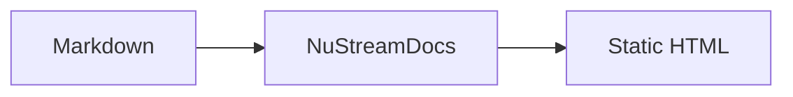

# Mermaid Diagrams & Image Lightbox

**Packages**: `NuStreamDocs.Mermaid`, `NuStreamDocs.Lightbox`

## `NuStreamDocs.Mermaid`

Retags fenced `mermaid` code blocks into `<pre class="mermaid">...</pre>` elements and injects the Mermaid diagram script into `<head>` so flowcharts, sequence diagrams, and state diagrams render automatically.

```csharp
using NuStreamDocs.Mermaid;
using NuStreamDocs.SuperFences;

builder
    .UseSuperFences()
    .UseMermaid();
```

````markdown

````

---

## `NuStreamDocs.Lightbox`

Wraps content `` elements in `glightbox` anchor triggers and ships the bundled `glightbox` CSS and JavaScript assets so readers can click any screenshot or diagram to zoom in an accessible modal overlay.

```csharp
using NuStreamDocs.Lightbox;

builder.UseLightbox();
```
